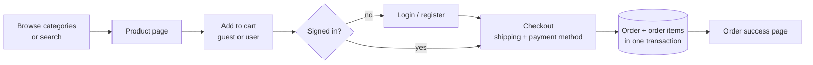
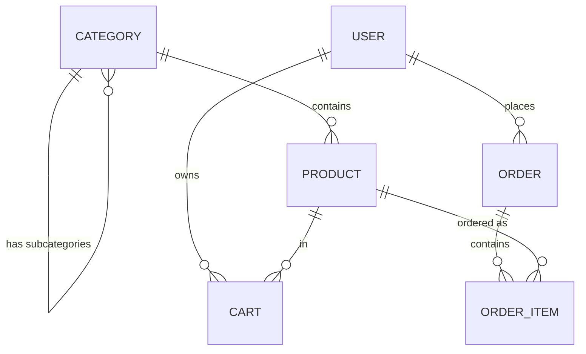

<h1 align="center">🛒 E-commerce Site</h1>

<p align="center">An online store built with <strong>Laravel 8</strong>: browse categories and products, search with autocomplete, keep a cart as a guest or a signed-in user, and check out to place orders.</p>

<p align="center">
  
  
  
  
  
</p>

<p align="center">
  <a href="#-features"><b>Features</b></a> ·
  <a href="#-how-a-purchase-flows">Purchase flow</a> ·
  <a href="#-data-model">Data model</a> ·
  <a href="#-getting-started">Getting started</a> ·
  <a href="#-routes">Routes</a>
</p>

---

## ✨ Features

- **Catalog.** Six top-level categories (Electronics, Fashion, Home & Living, Books, Sports, Beauty), each with subcategories, and products with a price and a compare-at price.
- **Search.** Full search page plus an autocomplete endpoint.
- **Cart.** Works for guests (tracked by session) and for signed-in users (tracked by user). Add, update quantity, remove, and a live item count.
- **Accounts.** Register, log in and out, forgot and reset password, and a dashboard. Login and register share one combined form.
- **Checkout.** Validated shipping details and cash on delivery. Orders get an `ORD-` number and are written in a database transaction.
- **Orders.** Order history, order detail and a success page for signed-in users.
- **Pricing rules.** Shipping is free above 50 and 10 otherwise; tax is 10% of the subtotal.

## 🔁 How a purchase flows



## 🗃️ Data model



## 🧰 Tech stack

| Layer | Tools |
|---|---|
| Backend | Laravel 8, PHP 7.3 or 8, Laravel Sanctum, Laravel Breeze (auth scaffolding) |
| Database | MySQL (configured in `.env.example`) |
| Frontend | Blade templates, Tailwind CSS 2, Alpine.js 3, Axios |
| Build | Laravel Mix |
| Tests | PHPUnit |

## 🚀 Getting started

Requires PHP, Composer, Node.js and a MySQL database.

```bash
git clone https://github.com/faizankhan789/ecommerce-site.git
cd ecommerce-site

composer install
npm install

cp .env.example .env
php artisan key:generate
# edit .env: set DB_DATABASE, DB_USERNAME, DB_PASSWORD

php artisan migrate
php artisan db:seed --class=CategoryProductSeeder   # sample categories and products

npm run dev          # build assets (or `npm run watch`)
php artisan serve    # http://127.0.0.1:8000
```

Run the tests with `php artisan test` (or `vendor/bin/phpunit`).

## 🧭 Routes

| Area | Routes |
|---|---|
| Home and auth | `/`, `/login`, `/register`, `/forgot-password`, `/reset-password`, `/dashboard` |
| Catalog | `/categories`, `/category/{slug}`, `/products`, `/product/{slug}`, `/api/subcategories/{parentId}` |
| Search | `/search`, `/search/autocomplete` |
| Cart | `/cart`, `/cart/add`, `/cart/update/{id}`, `/cart/remove/{id}`, `/cart/count` |
| Checkout and orders (login required) | `/checkout`, `/checkout/process`, `/orders`, `/orders/{orderNumber}`, `/orders/success/{orderNumber}` |

## 📁 Project structure

```text
app/
  Http/Controllers/   Auth/, Category, Product, Search, Cart, Checkout, Order
  Models/             User, Category, Product, Cart, Order, OrderItem
database/
  migrations/         users, categories, products, carts, orders and order items
  seeders/            CategoryProductSeeder (sample catalog)
resources/views/      auth, cart, categories, checkout, orders, products, search, layouts
routes/web.php        all web routes
```

## 📄 License

Built on the Laravel framework, which is open-source software licensed under the [MIT license](https://opensource.org/licenses/MIT). This project's `composer.json` declares `MIT`.
